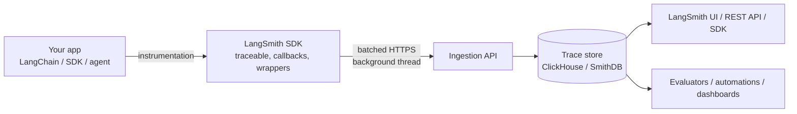

# LangSmith — Complete Theory Notes

> Companion to [`README.md`](README.md). The README is the hands-on log of this repo;
> this file is the theory behind it: what LangSmith is, how tracing works, how the data
> model fits together, how evaluation is designed, and where the sharp edges are.
>
> Docs evolve quickly. This reflects the platform as of **November 2026** and the
> concepts used by the scripts in this repo.

---

## Table of contents

1. [The problem: LLM apps are non-deterministic systems](#1-the-problem-llm-apps-are-non-deterministic-systems)
2. [What LangSmith is (and is not)](#2-what-langsmith-is-and-is-not)
3. [Architecture: how a trace gets to the UI](#3-architecture-how-a-trace-gets-to-the-ui)
4. [Data model: runs, traces, threads, trajectories](#4-data-model-runs-traces-threads-trajectories)
5. [Tracing theory](#5-tracing-theory)
6. [Reading and debugging a trace](#6-reading-and-debugging-a-trace)
7. [Monitoring and production observability](#7-monitoring-and-production-observability)
8. [Evaluation theory](#8-evaluation-theory)
9. [Prompt engineering and versioning](#9-prompt-engineering-and-versioning)
10. [Security, privacy and compliance](#10-security-privacy-and-compliance)
11. [Cost and performance theory](#11-cost-and-performance-theory)
12. [Best practices and anti-patterns](#12-best-practices-and-antipatterns)
13. [Mapping to this repository](#13-mapping-to-this-repository)
14. [Glossary](#14-glossary)
15. [References](#15-references)

---

## 1. The problem: LLM apps are non-deterministic systems

A traditional web request is mostly deterministic: given the same database state and
input, you can usually reproduce the result. An LLM application is not:

- the model samples from a probability distribution (`temperature > 0`),
- retrieval depends on embeddings and chunking, so the context changes,
- agents choose tools and arguments at runtime,
- providers change model versions underneath you,
- prompts are natural language, so tiny edits have non-local effects.

A failure can originate in **any** layer:

| Layer | Typical failure |
| --- | --- |
| Prompt | ambiguous instruction, missing variable, bad formatting |
| Retrieval | wrong chunk retrieved, chunk too large/small, stale index |
| Model | hallucination, refusal, malformed output, timeout |
| Tools | wrong tool chosen, bad arguments, upstream API error |
| Parser | schema mismatch, silent truncation |
| Orchestration | step skipped, loop, wrong branch, parallel race |
| Infrastructure | rate limit, retry storm, high latency, cost spike |

`print()` gives you the final string only. You need to see **the whole execution**:
inputs, outputs, nesting, timing, tokens, cost and errors of every step. That is
observability for LLM apps.

### Observability vs monitoring vs evaluation vs testing

These are related but distinct:

| Practice | Question it answers | Data |
| --- | --- | --- |
| **Observability** | What exactly happened in this one run? | traces, spans, logs |
| **Monitoring** | Is the system healthy over time? | aggregates, dashboards, alerts |
| **Evaluation** | How good are the outputs, comparatively? | datasets, scores, experiments |
| **Testing** | Does it meet hard requirements? | assertions, CI pass/fail |

Evaluation measures quality (often fuzzy and relative). Testing asserts correctness
(binary, deploy-blocking). A metric can become a test, e.g. "new version must not
score below the baseline by more than 2%".

The loop that matters:

```
trace real behaviour → find failures → curate examples → run experiments
        ↑                                                    ↓
        └──────────── deploy → monitor → collect new traces ┘
```

This loop is often called the **data flywheel**: production traces become datasets,
datasets drive evaluations, evaluations justify changes, changes ship to production.

---

## 2. What LangSmith is (and is not)

**LangSmith** is LangChain's platform for **observability, evaluation, prompt
engineering and agent deployment**. It is framework-agnostic: first-class support for
LangChain and LangGraph, plus integrations for OpenAI, Anthropic, Gemini, CrewAI,
Pydantic AI, Vercel AI SDK and others, and a generic SDK/OpenTelemetry path.

Main capability groups:

| Area | What it gives you |
| --- | --- |
| **Observability** | traces, threads, run trees, inputs/outputs, latency, tokens, cost, errors |
| **Monitoring** | prebuilt/custom dashboards, alerts, automation rules, online evaluators |
| **Evaluation** | datasets, examples, experiments, evaluators, comparison, annotation queues |
| **Prompt engineering** | Prompt Hub, commits/tags/environments, Playground, dataset tests |
| **Agent engineering** | Insights (usage analytics), Engine (issue detection + fixes), Studio |
| **Deployment** | agent servers, sandboxes; LLM Gateway for model calls |

### What it is not

- Not an LLM or a model provider.
- Not a vector database — your retriever/vector store is separate.
- Not a runtime: it does not execute your app. It receives telemetry.
- Not a replacement for application logs/metrics — it complements them.
- Not free of data-governance concerns: traces contain prompts and outputs.

### Hosting and regions

LangSmith can run as:

- **Cloud** — US, EU, APAC (and AWS/Azure-hosted variants). The API endpoint must match
  the account region or authentication fails.
- **Hybrid** — data plane in your cloud, control plane managed.
- **Self-hosted** — inside your infrastructure, for strict compliance.

The UI is `smith.langchain.com`; the API endpoint is configured with
`LANGSMITH_ENDPOINT` (legacy: `LANGCHAIN_ENDPOINT`).

### Plans and retention (important for design)

SaaS trace retention has two tiers: **base** and **extended**. At the time of writing,
base is 14 days and extended is 180 days. Retention is set per tracing project (or per
agent environment) and changes apply to new traces only. Features such as online
evaluators and automation rules can automatically upgrade matching traces to extended
retention — which also affects billing. **Datasets persist indefinitely**, even after
the source trace is deleted. That is why "add interesting traces to a dataset" is the
standard way to keep valuable production examples.

---

## 3. Architecture: how a trace gets to the UI

Conceptually:



Key consequences of this design:

1. **Tracing is asynchronous.** The SDK buffers and sends runs in a background thread
   so your request is not blocked. Short-lived scripts can exit before the flush — call
   `client.flush()` or use a graceful shutdown when needed. LangChain flushes on exit
   in normal cases.
2. **Network and auth matter.** Wrong region endpoint or missing API key means silent
   (or logged) failure to ingest. Tracing should never crash the app.
3. **Batching and limits.** The SDK batches run operations (up to ~100 runs per call).
   APIs are rate-limited; the SDK retries with backoff. Very chatty agents can hit
   hourly event limits.
4. **Sampling is a first-class tool.** You do not have to send every trace:
   `LANGSMITH_TRACING_SAMPLING_RATE` (0–1) or per-`Client` sampling.
5. **The platform only knows what you send.** If you hide inputs/outputs, debugging
   gets harder; if you send secrets, they are stored (subject to retention).

### Instrumentation paths

| Path | When to use |
| --- | --- |
| **Framework integration** | LangChain/LangGraph — one env var, automatic child spans |
| **Provider wrapper** | e.g. `wrap_openai`, `wrap_anthropic` — raw SDK calls traced |
| **`@traceable`** | any Python/TS function; recommended manual approach |
| **`trace` context manager** | trace a block of code, or set inputs/outputs manually |
| **`RunTree` API** | low-level explicit tree construction (rare) |
| **OpenTelemetry** | send OTel spans to LangSmith; use a collector for redaction/routing |

Runs map naturally to **OpenTelemetry spans**; a trace is an OTel trace. This makes
LangSmith compatible with the broader observability ecosystem.

---

## 4. Data model: runs, traces, threads, trajectories

### Hierarchy

```
Organization
└── Workspace
    ├── Agent  (agent-based workspaces)
    │   ├── Production environment  ─┐
    │   ├── Staging environment      ├─ each is a backing tracing project
    │   ├── Development environment  │
    │   └── Local environment       ─┘
    └── Tracing project (project-based workspaces / self-hosted)
        └── Trace
            └── Run (root)
                ├── Run (child)
                │   └── Run (grandchild)
                └── Run (child)
```

Two workspace styles exist:

- **Agent-based** (newer Cloud): traces are addressed by agent + environment
  (`LANGSMITH_AGENT_ID`, `LANGSMITH_AGENT_ENVIRONMENT`). The four environments are
  `production`, `staging`, `development`, `local`.
- **Project-based** (legacy Cloud and self-hosted): traces are addressed by a tracing
  project name (`LANGSMITH_PROJECT` / legacy `LANGCHAIN_PROJECT`).

The APIs still expose `project_name`/`session_id` because an environment is backed by a
tracing project. When in doubt, check the workspace control in the top-left of the UI.

### Run = span

A **run** is one unit of work: an LLM call, a retrieval, a tool call, a prompt
formatting step, a parser, or any traced function.

Important fields:

| Field | Meaning |
| --- | --- |
| `id` | UUID of the span |
| `trace_id` | UUID of the root run; groups the whole operation |
| `parent_run_id` | parent span, `null` for the root |
| `dotted_order` | sortable path encoding hierarchy and start time |
| `name` | display name (`run_name` or function/class name) |
| `run_type` | `chain`, `llm`, `tool`, `retriever`, `embedding`, `prompt`, `parser` |
| `inputs` / `outputs` | serialized payloads |
| `error` | error message if the run failed |
| `start_time` / `end_time` | timing; latency = end − start |
| `tags` | list of strings |
| `metadata` | key/value pairs (in `extra.metadata`) |
| `status` | `pending`, `success`, `error` |
| `total_tokens`, `prompt_tokens`, `completion_tokens` | usage |
| `total_cost`, `prompt_cost`, `completion_cost` | cost, when pricing is known |
| `first_token_time` | streaming time-to-first-token |
| `session_id` | project/environment ID |
| `reference_example_id` | set for evaluation runs |
| `in_dataset` | whether the run is attached to a dataset |

`dotted_order` is worth understanding because it explains ordering:

```
20240919T171648521691Z<root-uuid>
  .20240919T171648523407Z<child-uuid>
  .20240919T171648523563Z<grandchild-uuid>
```

Each segment is `<start_time>Z<run_id>`. The first UUID is the `trace_id`; the last is
the run `id`; the penultimate is the `parent_run_id`. Dots encode depth, and the
timestamps make the string sortable, which is how parallel branches are ordered.

### Trace = tree of runs

A **trace** is every run caused by one operation (one user request). It is bounded:
**25,000 runs per trace** maximum. That is generous for normal agents but easy to hit
with unbounded loops — another reason to cap iterations.

### Thread = sequence of traces

A **thread** groups traces from a multi-turn session. Enable it by putting
`thread_id` (or `session_id`) in **metadata on every run**, including children:

```python
config = {
    "metadata": {"thread_id": thread_id},
    "run_name": "chat_turn",
}
chain.invoke(user_message, config=config)
```

Consequences of missing it on child runs: thread-level token counts, cost aggregation
and thread filters will be incomplete. Threads power conversation-level debugging and
multi-turn online evaluators.

### Trajectory = flattened thread

A **trajectory** is a flat, ordered list of human/AI/tool messages for the session,
deduplicated and stripped of nesting. It answers "what was exchanged?" rather than
"what executed?". The UI exposes **Trajectory**, **Turns** and **Details** views.

### Comparison

| | Trace | Thread | Trajectory |
| --- | --- | --- | --- |
| Shape | tree of runs | sequence of traces | flat ordered messages |
| Contains | every run with full I/O | every run in every linked trace | messages only |
| Use for | debugging one operation | multi-turn behaviour/timing | reading the conversation |

### Tags and metadata

- **Tags** — strings for filtering/grouping. Cheap and searchable.
- **Metadata** — structured key/values, e.g. `user_tier`, `model`, `prompt_version`,
  `tenant`, `thread_id`, `essay_length`.

Critical gotcha: **tags and metadata are not inherited**. If you attach metadata to the
root trace, child LLM runs do not automatically get it. Attach important dimensions
(e.g. `model`, `prompt_version`, `thread_id`) to both the root and the specific runs
you want to group in dashboards.

---

## 5. Tracing theory

### 5.1 Automatic instrumentation

For LangChain/LangGraph, tracing is enabled by environment variables:

| New (preferred) | Legacy (still supported) | Purpose |
| --- | --- | --- |
| `LANGSMITH_TRACING=true` | `LANGCHAIN_TRACING_V2=true` | enable tracing |
| `LANGSMITH_API_KEY=...` | `LANGCHAIN_API_KEY=...` | authenticate |
| `LANGSMITH_ENDPOINT=...` | `LANGCHAIN_ENDPOINT=...` | region/API URL |
| `LANGSMITH_PROJECT=...` | `LANGCHAIN_PROJECT=...` | destination project |
| `LANGSMITH_TRACING_SAMPLING_RATE=0.75` | — | sample a fraction of traces |

This repo uses the legacy `LANGCHAIN_*` names; they still work and are equivalent for
project-based tracing. New code should prefer `LANGSMITH_*`.

The integration hooks into LangChain's callback system, so every `invoke`, `stream`,
agent step, retriever call, tool call and parser becomes a nested run with no code
changes.

### 5.2 Manual instrumentation: `@traceable`

```python
from langsmith import traceable

@traceable(
    name="evaluate_language",      # display name
    run_type="chain",              # chain | llm | tool | retriever | ...
    tags=["dimension:language"],
    metadata={"dimension": "language"},
)
def evaluate_language(state):
    ...
```

Semantics:

- Decorating a function creates a run whose **inputs** are the function arguments and
  whose **outputs** are the return value.
- If the function is called inside another traced run (or inside a LangChain chain),
  it becomes a **child** of that run. Context propagation is automatic (contextvars),
  including through `asyncio` in normal usage.
- `run_type` changes rendering: `llm` gets token/latency views, `tool` gets tool views,
  `retriever` gets document views.
- Exceptions are captured and the run is marked `error` with a stack trace.
- `process_inputs` / `process_outputs` transform what is logged (redaction, trimming).
- `langsmith_extra={"run_id": ...}` lets you supply a UUIDv7 run ID for correlation.

Guideline: trace **decisions and I/O boundaries**, not every tiny helper. A trace with
200 spans is as unreadable as no trace.

### 5.3 `trace` context manager and `RunTree`

```python
import langsmith as ls

with ls.trace("pdf_rag_full_run", "chain", inputs={"question": q}) as run:
    answer = pipeline(q)
    run.end(outputs={"answer": answer})
```

Use the context manager when a decorator is awkward (dynamic inputs/outputs, partial
blocks, non-function scopes). `RunTree` is the low-level API: create/post/end/patch
runs manually. It gives full control but you must manage context yourself — not
recommended unless you are building an integration.

### 5.4 Run lifecycle

1. **Create** — name, type, inputs, start time, tags, metadata, parent/trace IDs.
2. **Update(s)** — streaming events, token counts, partial outputs.
3. **End** — outputs or error, end time, status.
4. **Post** — SDK batches and sends to the ingestion API.

Because creation and update are separate operations, a run can appear as `pending`
while it executes. Errors set `status=error` and populate `error`.

### 5.5 Naming, tags and metadata strategy

Treat traces as a schema, not an afterthought:

- `run_name` — verb + object, stable across versions: `pdf_rag_query`,
  `evaluate_language`.
- `tags` — low-cardinality dimensions for filtering: `env:prod`, `dimension:language`,
  `experiment:v2`.
- `metadata` — high-cardinality context: `prompt_version`, `model`, `user_id_hash`,
  `tenant`, `thread_id`, `k`, `chunk_size`, `essay_length`.

Put **the same key** on the root and on the LLM runs if you want dashboards grouped by
that key at both levels. Names should not contain IDs or timestamps (cardinality
explosion); put those in metadata.

### 5.6 Sampling and conditional tracing

For high-volume production:

- **Probabilistic sampling**: `LANGSMITH_TRACING_SAMPLING_RATE=0.1` keeps 10%.
  Good for cost control while preserving a statistically representative sample.
- **Per-client sampling**: `Client(tracing_sampling_rate=0.5)`, used with
  `tracing_context(client=...)`.
- **Conditional tracing**: deterministically enable/disable or route traces based on
  tenant, environment, data sensitivity, or feature flag.
- **Error-biased retention**: sample normal traffic aggressively, but keep 100% of
  errors — usually via automation rules/retention upgrades rather than sampling logic.

Sampling interacts with evaluation: if you evaluate online on sampled traces, your
metrics are estimates, with variance proportional to sample size.

### 5.7 Ensure traces are submitted

The SDK sends asynchronously. In long-running services this is fine. In scripts,
notebooks, serverless functions and tests:

```python
from langsmith import Client

client = Client()
...
client.flush()  # before process exit
```

LangChain integrations normally flush at interpreter exit, but explicit flushing is
safer in short-lived processes.

### 5.8 Trace enrichment beyond tags/metadata

- **Feedback** — scores/comments attached to a run (user thumbs up/down, evaluator
  score, reviewer rubric).
- **Attachments** — larger artifacts linked to a run (e.g. files, images) rather than
  stuffed into inputs/outputs.
- **Reference example** — links an evaluation run to its dataset example.
- **Thread metadata** — `thread_id`/`session_id` to group turns.

---

## 6. Reading and debugging a trace

### Views

- **Details** — the run tree with inputs, outputs, attributes, timing, errors.
- **Trajectory** — chat-style messages for the trace/thread.
- **Turns** — each conversation turn as a card (thread context).
- **Threads** — list of sessions with turn count, latency, tokens, cost, feedback.

### A practical debugging method

1. **Start from the symptom.** Error rate, P99 latency, negative feedback, or a wrong
   answer.
2. **Find the right trace.** Filter by tag/metadata (`run_name`, `model`,
   `prompt_version`, `thread_id`), status, latency, feedback key.
3. **Open the failing span first**, not the root. Most latency and errors live in one
   child.
4. **Check the retriever output** (RAG): are the right chunks present? This is the
   most common RAG failure and is invisible in the final answer.
5. **Check the prompt input**: variables filled, context not truncated, system prompt
   correct, no injection.
6. **Check the model output**: refusal, truncation, malformed JSON, hallucination.
7. **Check the parser**: did valid model output become invalid structured output?
8. **Check timing**: which span dominates? Network? Embedding? Model? Tool?
9. **Check tokens/cost**: a sudden jump often means context blow-up or a loop.
10. **Reproduce** by replaying the same inputs in the Playground or locally.

### Latency interpretation

- **P50** — typical experience.
- **P99** — tail; what your unluckiest 1% sees. Tail latency is often a queue,
  provider hiccup, retry, or a long tool call.
- **Time to first token** — matters for streaming UX; total latency can be high while
  perceived latency is fine.

### What to compare

- Same app, two time windows (regression after deploy).
- Two models/prompts on the same dataset (experiments).
- Two traces of the same run name with different metadata.
- A trace vs its thread (single turn looked fine; conversation context was wrong).

---

## 7. Monitoring and production observability

### Metrics that matter

| Metric | Why |
| --- | --- |
| Trace/run count | traffic, adoption, anomalies |
| Error rate | reliability; parsing/tool/model failures |
| Latency P50/P99 | UX and capacity |
| Time to first token | streaming UX |
| Tokens (prompt/completion) | cost and context growth |
| Cost | budget; model/route decisions |
| Feedback score | quality as users experience it |
| Tool error/latency by tool | which integration is fragile |

### Dashboards

- **Prebuilt** for every tracing project/environment: traces, LLM calls, cost & tokens,
  tools, run types, feedback scores.
- **Custom**: charts over one or more projects/datasets with metrics (count, latency,
  TTFT, tokens, cost, feedback, ratio), filters (run/trace/tree level), group-by
  (run name, run type, tag, project, metadata path, feedback label) and visualizations
  (line, bar, KPI, ranked bar, donut, table).
- **Alerts** fire when a metric crosses a threshold (error rate, latency, cost, volume).

Remember the metadata non-inheritance rule when grouping: attach the key to both root
and LLM runs if you need it in both trace-level and LLM-level charts.

### Automation rules

A rule = **item type** (runs or threads) + **filter** + **sampling rate** + **actions**.
Actions include:

- add to annotation queue,
- add to dataset,
- trigger webhook (e.g. remote evaluation, Slack/Jira via integration),
- run online/custom-code evaluator,
- extend data retention,
- trigger alert.

Within a rule, actions execute in a fixed order (queue → dataset → webhook → online
evaluator → custom evaluator → retention → alert). Rules poll independently, so if one
rule depends on another's output, express that dependency with a filter, not luck.

Thread rules wait until the thread is idle (default ~10 minutes, minimum 2) and then act
on the whole conversation. This is how you review full sessions rather than single
turns.

### Online evaluation

Online evaluators run on live traces (and optionally threads) with no reference
outputs. They are necessarily **reference-free**: safety, format, tone, helpfulness,
policy compliance, groundedness heuristics, LLM-as-judge rubrics. Sampling rates keep
judge cost under control; filters target risky traffic (e.g. low-confidence, long,
error, specific tenant).

### Insights vs Engine

- **Insights** — analytics. Automatically or manually clusters traces into categories
  and reports metrics per category. Answers: *how are people using the agent?*
- **Engine** — agent-for-agent-engineering. Scans traces, detects recurring issues,
  diagnoses root cause (optionally with repo access), proposes fixes as PRs, and creates
  dataset examples. Answers: *what is going wrong and what should we change?*

Both consume traces; neither replaces human review.

### Production observability checklist

- Name every root run and every meaningful span.
- Tag environment/version; put model and prompt version in metadata on root + LLM runs.
- Sample normal traffic; keep errors and negative feedback fully.
- Create dashboards for error rate, P99, cost, feedback.
- Alert on leading indicators (error spike, token spike, TTFT regression).
- Route negative feedback to a queue and to a dataset automatically.
- Redact PII/secrets before ingestion.
- Set retention tiers deliberately; promote valuable traces to datasets.

---

## 8. Evaluation theory

### Why evaluation is hard

LLM outputs are non-deterministic and often subjective. There is no single "correct"
answer for a summary or an essay. Evaluation therefore:

- defines **what good looks like** through examples and rubrics,
- measures **relative** quality across versions,
- relies on **multiple weak signals** (code checks + judge + humans),
- must account for **variance** (repeat runs, sample size).

### Core objects

| Object | Definition |
| --- | --- |
| **Dataset** | collection of examples used for evaluation |
| **Example** | `inputs` + optional `reference outputs` + optional `metadata` |
| **Split** | named subset of a dataset (train/validation/test, categories, staged rollout) |
| **Version** | snapshot of a dataset; LangSmith versions on change, tag milestones |
| **Experiment** | results of running one app version over a dataset: outputs, scores, traces |
| **Evaluator** | function/model that scores a run (and example) and returns feedback |
| **Feedback** | `key`, `score` or `value`, optional `comment`, bound to a run |

Datasets are the durable asset. Traces expire; datasets do not. Build datasets from:

1. **Hand-curated examples** — start with 10–20 covering core behaviour and edge cases.
2. **Production traces** — negative feedback, errors, high latency, unusual tool usage.
3. **Synthetic examples** — generate variations from high-quality seeds (careful:
   synthetic data inherits the generator's biases).

### Offline vs online evaluation

| | Offline | Online |
| --- | --- | --- |
| Runs on | dataset examples | live traces/threads |
| Has reference outputs | yes (optional but typical) | no |
| Purpose | benchmarking, regression, unit tests, backtesting | monitoring, anomaly detection, real-world quality |
| Trigger | before deploy, in CI | continuously in production |
| Evaluator style | reference-based and reference-free | reference-free only |

Offline evaluation supports:

- **Benchmarking** — compare prompts/models/architectures.
- **Regression testing** — block a deploy if quality drops.
- **Unit testing** — verify one component (retrieval, parser, tool selection).
- **Backtesting** — run a new version on historical cases.

### Evaluator taxonomy

| Type | How it scores | Strengths | Weaknesses |
| --- | --- | --- | --- |
| **Human** | rubric review, annotation queue | ground truth for nuance | slow, expensive, subjective |
| **Code** | deterministic function | fast, cheap, reproducible | only checks what is codified |
| **LLM-as-judge** | LLM with rubric/prompt | scales nuance, reference-free or based | bias, cost, needs calibration |
| **Pairwise** | compare two outputs | easier than absolute scoring | needs two systems, position bias |
| **Decision model** | typed questions (probability/choice/level) | structured, calibrated judgments | newer, less familiar |

**Reference-free** evaluators work offline and online: safety, PII, format/JSON schema,
length, keyword presence, LLM-judged clarity/tone/helpfulness.

**Reference-based** evaluators need ground truth and are offline-only: exact match,
semantic similarity, factual accuracy vs reference, reference-based judging.

Code evaluators commonly check:

- output is non-empty and within length limits,
- JSON parses and matches a schema,
- required citations/fields exist,
- classification equals the label,
- generated code compiles/runs,
- retrieval contains the gold document (retrieval recall).

LLM-as-judge best practices:

1. Write an explicit **rubric** with levels and examples.
2. Use **structured output** (score + reasoning) so results are machine-readable.
3. Prefer **reference-based** or **pairwise** when possible — they are more stable than
   absolute 1–10 scores.
4. Include **few-shot** scored examples to anchor the judge.
5. **Calibrate against humans** on a sample; measure agreement, not vibes.
6. Watch known biases: position (A/B order), verbosity (longer looks better),
   self-preference (judge favors its own model family), sycophancy.
7. Randomize order in pairwise judging; run both orders when possible.
8. Keep the judge model fixed across an experiment; changing the judge changes the
   metric.
9. Log judge reasoning as `comment` so failures are debuggable.
10. Sample online judging; do not judge 100% of high-volume traffic by default.

### Evaluation code shape

```python
from langsmith import evaluate

def target(inputs: dict) -> dict:
    # your app; must accept the example inputs dict
    return {"answer": run_app(inputs["question"])}

def exact_match(run, example) -> dict:
    return {
        "key": "exact_match",
        "score": float(run.outputs["answer"] == example.outputs["answer"]),
    }

results = evaluate(
    target,
    data="essay-eval-set",              # dataset name or iterator of examples
    evaluators=[exact_match],
    experiment_prefix="baseline-v1",    # groups results as an experiment
)
```

An LLM judge is just another evaluator returning feedback:

```python
def judge(run, example) -> dict:
    verdict = judge_model.invoke(
        f"Question: {example.inputs['question']}\n"
        f"Reference: {example.outputs['answer']}\n"
        f"Candidate: {run.outputs['answer']}\n"
        "Score factual correctness 0-1 and explain."
    )
    return {"key": "correctness", "score": verdict.score, "comment": verdict.reasoning}
```

### Experiment design

Treat an experiment like an A/B test, not a demo:

- **Fix everything except the variable** under test (model, prompt, retriever, params).
- **Use the same dataset version/split**; tag versions and reference them in CI.
- **Run repetitions** for non-deterministic systems; report mean and spread.
- **Compare paired outputs** per example; paired comparisons are more sensitive than
  aggregate averages.
- **Sample size**: small datasets give noisy conclusions. A 5-example dataset can show
  a 20% difference by chance.
- **Beware overfitting**: iterating prompts against the same test set turns it into a
  training set. Keep a held-out split.
- **Don't chase noise**: a 0.5% improvement on 20 examples is not a result.
- **Record confounders**: model version, judge version, temperature, retrieval index.
- **Ship on a combination**: offline score + online guardrails + cost/latency.

### Evaluation vs testing, again

- **Eval**: "v2 is better than v1 on 78% of examples, +0.06 mean score, cost +12%."
- **Test**: "JSON must parse", "no PII", "latency < 3s", "regression score ≥ baseline".

Run both in CI when possible (pytest/Vitest integrations exist). Use evals for
direction, tests for guarantees.

### Human review and annotation queues

- **Single-run queues** — review one run against rubric items; ideal for triage and
  building datasets.
- **Pairwise queues** — compare two runs side by side; ideal for fast A/B preference.
- **Assertions** — free-form acceptance criteria attached to a queue item that an
  offline evaluator can later grade against.
- Reviewers can be assigned, reservations avoid conflicts, and annotated runs export
  directly to datasets.

A good rubric is observable and specific ("mentions all three causes", "no unsupported
claims"), not vague ("good answer"). If two reviewers disagree consistently, the rubric
is the problem.

---

## 9. Prompt engineering and versioning

### Prompts are code

- **Prompt** = messages sent to the model.
- **Prompt template** = reusable prompt with variables filled at runtime.
- **Chat format** (roles) is the default; **completion format** (single string) is
  legacy.
- Template syntax: **f-string** (default) or **mustache** (conditionals/loops, more
  flexible).
- Tools and structured output schemas are part of the prompt's contract. With tools the
  model *may* choose one or more; with structured output it *always* returns the schema.

### Prompt Hub

- Every save creates a **commit** with a hash; you can diff, revert and reference a
  specific version in code.
- **Tags** are movable labels (`v1`, `staging`, `production`) pointing at commits.
  `staging`/`production` are reserved for the environments feature, which promotes
  versions without code changes.
- Pull by name or pinned commit/tag:
  `client.pull_prompt("essay-evaluator:production")`.
- Prompts can store a model configuration (model, temperature) alongside the template.

### Playground

- Change model, prompt, output schema and tools.
- Fill variables and run.
- Compare multiple prompts side by side.
- Run over a dataset with repetitions to get an experiment.
- Best used for **exploration**; confirm with a real evaluate() run and a held-out set.

### Prompt versioning discipline

1. Version prompts in the Hub (or a repo) — never "edit in prod".
2. Log `prompt_version` in trace metadata for every run.
3. Change one thing at a time; evaluate on a fixed dataset.
4. Promote via tag (`staging` → `production`), not by redeploying code.
5. Keep a rollback path and compare experiments after promotion.

---

## 10. Security, privacy and compliance

Traces are a copy of your application's data. Treat them accordingly.

### Secrets

- Keep model/LangSmith keys in `.env` or a secret manager; never commit them.
- If a key is committed, **rotate it**; deleting the commit is not enough (history,
  forks, caches, scrapers).
- LangSmith can redact known secret patterns in traces, but prevention is better.

### Masking and redaction options

| Technique | Effect |
| --- | --- |
| `LANGSMITH_HIDE_INPUTS=true` / `LANGSMITH_HIDE_OUTPUTS=true` | send no inputs/outputs at all |
| `Client(hide_inputs=..., hide_outputs=...)` | transform inputs/outputs per client |
| `Client(hide_metadata=True)` or a callable | drop/transform metadata |
| `create_anonymizer([...])` | regex-based masking (emails, UUIDs, keys) |
| `@traceable(process_inputs=..., process_outputs=...)` | per-function transformation |
| Conditional tracing / `tracing_context` | do not trace sensitive requests at all |
| OTel collector gateway | redact before data reaches LangSmith |
| Presidio / cloud DLP | advanced PII detection/redaction |

Masking reduces debuggability — decide per data class. Hiding everything satisfies
compliance but destroys observability.

### Retention and deletion

- Retention is per project/environment, with base and extended tiers.
- Deletion removes inputs/outputs after the period; some metadata may remain for
  analytics/billing.
- **Datasets persist indefinitely** — adding a trace to a dataset copies its data and
  keeps it. That is a feature and a compliance obligation.
- Automation rules and online evaluators can silently upgrade retention (and cost).
- Self-hosted/hybrid deployments exist for data residency and strict control.

### Access control

- Organization → workspace → project/environment permissions.
- API keys and personal access tokens are scoped; service accounts exist.
- Shared/public traces use share tokens — review before sharing.
- Audit logs and SSO/SCIM exist at organization level.

### Prompt injection and agent safety

Tracing helps you detect injection after the fact (unexpected tool calls, data
exfiltration attempts), but it is not a guardrail. Pair observability with:

- allow-listed tools and scoped credentials,
- output/input validation,
- human approval for destructive actions,
- `max_iterations` and timeouts,
- red-teaming before launch.

---

## 11. Cost and performance theory

### Where cost comes from

1. **Trace ingestion** — billed per trace, with a higher price for extended retention.
2. **Model tokens** — your provider bill; LangSmith reports tokens/cost when the
   integration can infer them.
3. **Evaluation** — judge model calls; offline experiments and online evaluators.
4. **Engine** — LangChain Standard Units (LSUs) for analysis/inference.
5. **Storage/retention** — extended retention upgrades.

### Levers

- **Sampling** normal traffic; keep errors/negative feedback.
- **Retention** tiers: base for noisy dev traffic, extended only where valuable.
- **Datasets** for anything you need to keep long-term (cheaper than retaining traces).
- **Payload hygiene**: don't log full documents if a summary/ID suffices; trim
  metadata; avoid duplicating large contexts across spans.
- **Batching**: SDK already batches; avoid tiny chatty runs per token.
- **Caching**: cache embeddings/indexes (see `3_rag_v4.py`), prompt results where
  semantically safe, and use provider prompt caching.
- **Cheaper models** for judges/auxiliary steps; keep the judge fixed per experiment.
- **Bound agents**: max iterations, token budgets, timeouts.

### Performance theory

- End-to-end latency is the **sum along the critical path** of the run tree, not the sum
  of all spans (parallel branches overlap).
- Optimize the **dominant span** first. In RAG, that is usually the LLM call or
  embedding at index time; at query time, retrieval is usually fast and generation
  dominates.
- Streaming improves **perceived** latency (TTFT) without reducing total time.
- Retries and tool timeouts often explain P99 spikes.
- Cold starts affect serverless agents; index building affects first RAG request.
- Token growth per turn increases latency and cost superlinearly in long threads;
  summarize/trim history.

### Token/cost accounting caveats

- Cost is only as accurate as the pricing table and reported usage.
- Custom/raw calls without usage metadata may show zero cost.
- Cached tokens and reasoning tokens may be billed differently.
- Compare **per-trace** and **per-successful-answer** cost, not just totals.

---

## 12. Best practices and anti-patterns

### Checklist

**Tracing**

- [ ] One meaningful root run per request/turn.
- [ ] Stable, descriptive run names; no IDs in names.
- [ ] Parent/child structure mirrors the app.
- [ ] Tags for environment/version/dimension; metadata for model/prompt/user context.
- [ ] `run_type` set correctly (especially `llm`, `tool`, `retriever`).
- [ ] Errors captured; no silent `except: pass` around traced work.
- [ ] Threads get `thread_id` on every run.
- [ ] Short-lived processes call `flush()`.

**Evaluation**

- [ ] Start with 10–20 hand-curated examples.
- [ ] Define rubrics before choosing judges.
- [ ] Mix code checks with LLM judges and human review.
- [ ] Calibrate the judge against humans.
- [ ] Fix dataset version/split per experiment.
- [ ] Repeat non-deterministic runs; report variance.
- [ ] Keep a held-out split; don't tune on the test set.
- [ ] Track cost/latency alongside quality.

**Production**

- [ ] Sampling + error-biased retention.
- [ ] Dashboards + alerts on error rate, P99, cost, feedback.
- [ ] Negative feedback → queue/dataset automatically.
- [ ] Online evaluators on risky traffic, sampled.
- [ ] PII/secrets redacted before ingestion.
- [ ] Retention tiers and spend limits set deliberately.

### Anti-patterns

| Anti-pattern | Why it hurts |
| --- | --- |
| Untagged/unnamed traces | unfindable; dashboards are useless |
| Logging only the final answer | no way to locate the failing step |
| One giant span for the whole app | no latency/error attribution |
| Tracing every helper | noise; harder to read than logs |
| IDs/timestamps in `run_name` | cardinality explosion |
| Metadata only on the root | child/dashboard grouping silently breaks |
| 1–10 LLM judge with no rubric | inconsistent, uncalibrated scores |
| Evaluating on the tuning set | overfitting; fake improvements |
| Chasing tiny deltas on tiny datasets | noise treated as signal |
| 100% online judging | cost blow-up |
| Sending raw PII/secrets | compliance incident |
| Relying on the platform as a guardrail | tracing is after-the-fact |
| Assuming traces are permanent | base retention is short; use datasets |

---

## 13. Mapping to this repository

| Script | Theory in action | What to look for in LangSmith |
| --- | --- | --- |
| `1_simple_llm_call.py` | automatic instrumentation of LCEL | one trace: prompt → ChatGroq → parser, tokens/latency |
| `2_sequential_chain.py` | run config, tags/metadata, two-stage chain | two LLM spans; filter by tag; metadata `topic` |
| `3_rag_v1.py` | RAG anatomy: load → split → embed → retrieve → generate | retriever span and retrieved chunks; grounding prompt |
| `3_rag_v2.py` | `@traceable` on setup functions | `setup_pipeline` with `load_pdf`, `split_documents`, `build_vectorstore` children |
| `3_rag_v3.py` | single root run, nested parent/child spans | `pdf_rag_full_run` → `setup_pipeline` + `pdf_rag_query` |
| `3_rag_v4.py` | caching + traced cache hit/miss | `load_index` vs `build_index`; `.indices/<sha>` |
| `4_agent.py` | ReAct loop + tools | thought/tool/observation iterations, tool errors |
| `5_langgraph.py` *(next)* | graph fan-out/fan-in, per-node traces | parallel dimension nodes, join, `Annotated` reducer |

Environment note: these scripts set `LANGCHAIN_PROJECT` and read `LANGCHAIN_*` from
`.env`. That is the legacy but still-supported naming; new code should use
`LANGSMITH_*`.

---

## 14. Glossary

| Term | Meaning |
| --- | --- |
| **Agent (workspace)** | Container for an app's traces, divided into environments |
| **Environment** | Production/staging/development/local bucket of traces |
| **Tracing project** | Legacy container of traces (backing store for an environment) |
| **Run / span** | One unit of work with inputs, outputs, timing, status |
| **Trace** | Tree of runs for one operation, joined by `trace_id` |
| **Thread** | Sequence of traces in a multi-turn session (`thread_id`) |
| **Trajectory** | Flat ordered list of messages in a thread |
| **Root run** | Top-level run of a trace |
| **`dotted_order`** | Sortable hierarchy path: `<time>Z<uuid>.<time>Z<uuid>` |
| **Run type** | `chain`, `llm`, `tool`, `retriever`, `embedding`, `prompt`, `parser` |
| **Tag** | String label for filtering |
| **Metadata** | Key/value context; not inherited by children |
| **Feedback** | Score/value + comment attached to a run |
| **Dataset** | Durable collection of evaluation examples |
| **Example** | Inputs + optional reference outputs + metadata |
| **Split** | Named subset of a dataset |
| **Experiment** | One app version evaluated over a dataset |
| **Evaluator** | Function/model that produces feedback |
| **LLM-as-judge** | Using a model to score outputs against a rubric |
| **Pairwise evaluation** | Comparing two outputs instead of absolute scoring |
| **Annotation queue** | Structured human review workflow |
| **Automation rule** | Filter + sampling + actions on new runs/threads |
| **Online evaluator** | Evaluator running on live traces, no references |
| **Insights** | Analytics/clustering of trace categories |
| **Engine** | Agent that detects, diagnoses and proposes fixes for recurring issues |
| **Prompt Hub** | Versioned prompt store with commits/tags |
| **Playground** | UI for iterating/testing prompts and tools |
| **Sampling rate** | Fraction of traces actually sent |
| **Flush** | Force pending async runs to be submitted |
| **TTFT** | Time to first token in streaming |
| **P50 / P99** | Median / tail latency percentiles |
| **LSU** | LangChain Standard Unit, used for Engine billing |
| **OTel** | OpenTelemetry; runs map to spans |

---

## 15. References

Core docs used for these notes:

- Observability concepts — <https://docs.langchain.com/langsmith/observability-concepts>
- Tracing quickstart — <https://docs.langchain.com/langsmith/observability-quickstart>
- Custom instrumentation (`@traceable`, `trace`, `RunTree`) — <https://docs.langchain.com/langsmith/annotate-code>
- Run data format and run types — <https://docs.langchain.com/langsmith/run-data-format>
- Threads — <https://docs.langchain.com/langsmith/threads>
- Sampling — <https://docs.langchain.com/langsmith/sample-traces>
- Masking/redaction — <https://docs.langchain.com/langsmith/mask-inputs-outputs>
- Dashboards — <https://docs.langchain.com/langsmith/dashboards>
- Automation rules — <https://docs.langchain.com/langsmith/rules>
- Evaluation concepts — <https://docs.langchain.com/langsmith/evaluation-concepts>
- Feedback data format — <https://docs.langchain.com/langsmith/feedback-data-format>
- Prompt engineering concepts — <https://docs.langchain.com/langsmith/prompt-engineering-concepts>
- Usage, retention and billing — <https://docs.langchain.com/langsmith/usage-and-billing>
- Engine — <https://docs.langchain.com/langsmith/engine>
- Full docs index — <https://docs.langchain.com/llms.txt>
