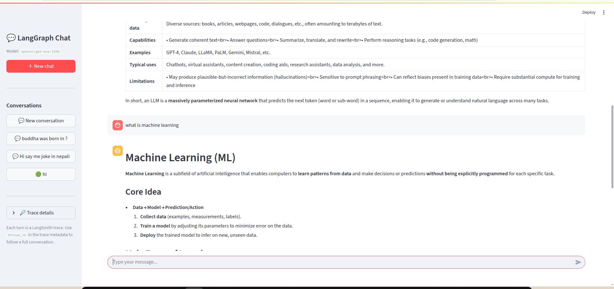
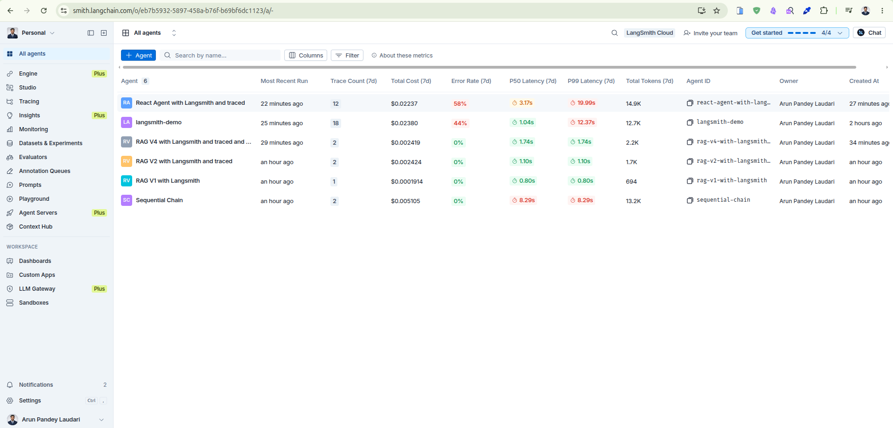
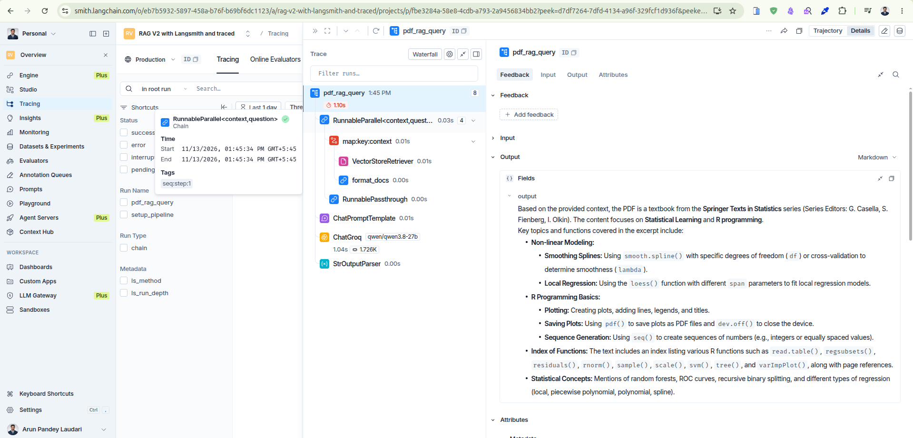
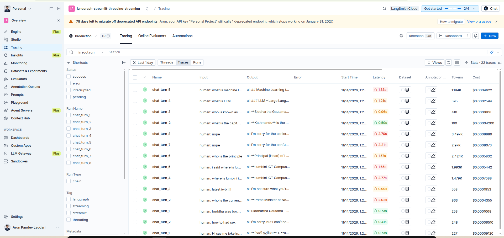
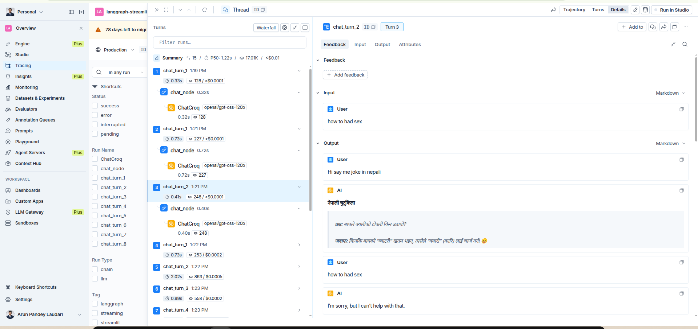

# LangSmith Fundamentals

Hands-on notes from learning **LangSmith** — LLM observability and tracing — with LangChain, Groq, FastEmbed and FAISS.

Each script is a small, self-contained step. The point is not the app itself, but **what the trace looks like in LangSmith** and which knobs control it (`run_name`, `tags`, `metadata`, nesting, project names).

> 📘 **Full theory notes:** see [`NOTES.md`](NOTES.md) for the complete conceptual guide —
> observability theory, data model, tracing internals, evaluation design, prompt
> versioning, security, cost and best practices.

---

## Why LangSmith?

When an LLM app misbehaves, `print()` is not enough. LangSmith records every step as a **trace** and shows:

- the full **run tree** — which chain / retriever / tool / LLM call ran, in what order
- **inputs and outputs** of every step
- **latency, token usage and cost**
- **errors**, retries and parsing problems
- **tags + metadata**, so runs can be filtered and compared
- (later) datasets, evaluators and feedback for systematic testing

Two ways to get traces:

1. **Automatic** — set `LANGCHAIN_TRACING_V2=true` and every LangChain/LangGraph invocation is traced.
2. **Manual** — wrap plain Python functions with `@traceable`.

---

## Setup

```bash
python -m venv .venv
source .venv/bin/activate
pip install -r requirements.txt
```

Create a `.env` file in the repo root (it is git-ignored):

```dotenv
GROQ_API_KEY=your_groq_key

LANGCHAIN_TRACING_V2=true
LANGCHAIN_ENDPOINT=https://api.smith.langchain.com
LANGCHAIN_API_KEY=your_langsmith_key
LANGCHAIN_PROJECT=langsmith-demo
```

> `LANGCHAIN_PROJECT` is the default project/destination. Most scripts override it with `os.environ["LANGCHAIN_PROJECT"] = "..."`, so each lesson lands in its own project in the UI.

Also place the source PDF (`islr.pdf`) in the repo root for the RAG scripts. It is ignored by git because of its size.

### Run the Streamlit chatbot

```bash
streamlit run 6_streamlit_threading_streaming.py
```

Each conversation gets its own LangGraph `thread_id`, replies stream token by token, and every turn appears in LangSmith as `chat_turn_<n>` with `thread_id`, `session_id`, turn number and model attached as metadata.



---

## Repository structure

| File | What it demonstrates |
| --- | --- |
| `1_simple_llm_call.py` | Smallest traced app: prompt → model → parser (LCEL) |
| `2_sequential_chain.py` | Chaining two prompts + models; `run_name`, `tags`, `metadata` |
| `3_rag_v1.py` | RAG from scratch: PDF → chunks → embeddings → FAISS → retrieval → answer |
| `3_rag_v2.py` | RAG + `@traceable` on the setup steps (`load_pdf`, `split_documents`, `build_vectorstore`) |
| `3_rag_v3.py` | Same pipeline, but grouped under a **single root run** with nested parent/child spans |
| `3_rag_v4.py` | RAG + **index caching** (fingerprint-based `.indices/`), so the vector store is built once |
| `4_agent.py` | ReAct agent with tools (DuckDuckGo search + weather API) and `AgentExecutor` |
| `5_langgraph.py` | LangGraph fan-out/fan-in essay evaluator with per-node traces |
| `6_streamlit_threading_streaming.py` | Streamlit chatbot: checkpointer + `thread_id` memory, token streaming, LangSmith metadata per turn |
| `screenshots/` | LangSmith UI and Streamlit app screenshots referenced below |
| `NOTES.md` | Complete theory notes: data model, tracing, evaluation, security, cost |

---

## Learning log

### 1. A simple LLM call is already a trace

`1_simple_llm_call.py`

```python
prompt = PromptTemplate.from_template("{question}")
model = ChatGroq(model="qwen/qwen3.8-27b")
parser = StrOutputParser()

chain = prompt | model | parser
chain.invoke({"question": "Who is salman Khan?"})
```

Learnings:

- LCEL (`prompt | model | parser`) is the basic building block; tracing needs no extra code.
- Once tracing env vars are set, **every `invoke()` becomes a run** in LangSmith.
- The trace already contains prompt text, model name, output, latency and token counts.

### 2. Sequential chains and run configuration

`2_sequential_chain.py`

```python
chain = prompt1 | model | parser | prompt2 | model | parser

config = {
    "run_name": "Sequential Chain",
    "tags": ["Sequential Chain", "Simple Chain", "Nov 13"],
    "metadata": {"topic": "Unemployment in Nepal"},
}
chain.invoke({"topic": "Unemployment in Nepal"}, config=config)
```

Learnings:

- Output of the first chain is fed into the second prompt — a two-stage pipeline.
- `config` is the main way to make traces findable:
  - **`run_name`** — readable name for the root run instead of the default chain name
  - **`tags`** — free-form labels for filtering/grouping
  - **`metadata`** — structured key/values (e.g. topic, model, dimensions)
- `LANGCHAIN_PROJECT` decides which project the run is stored in.

### 3. RAG v1 — the basic retrieval pipeline

`3_rag_v1.py`

Pipeline:

1. `PyPDFLoader` → one `Document` per page
2. `RecursiveCharacterTextSplitter(chunk_size=1000, chunk_overlap=150)`
3. `FastEmbedEmbeddings("BAAI/bge-small-en-v1.5")` → `FAISS` vector store
4. retriever with `k=4` similar chunks
5. `RunnableParallel` supplies **context** (retriever + `format_docs`) and **question** (`RunnablePassthrough`)
6. `prompt | llm | StrOutputParser`

Learnings:

- `RunnableParallel` is what lets context lookup and the raw question flow into the prompt together.
- The prompt is grounded: *"Answer ONLY from the provided context. If not found, say you don't know."*
- In the trace you can inspect the retrieved chunks — this is where bad RAG answers are usually diagnosed.
- RAG quality depends on chunk size/overlap, embedding model and `k`.

### 4. RAG v2 — tracing plain Python with `@traceable`

`3_rag_v2.py`

```python
@traceable(name="load_pdf", tags=[...], metadata={"PDF_PATH": PDF_PATH})
def load_pdf(path): ...

@traceable(name="split_documents")
def split_documents(docs, chunk_size=1000, chunk_overlap=150): ...

@traceable(name="build_vectorstore")
def build_vectorstore(splits): ...

@traceable(name="setup_pipeline")
def setup_pipeline(pdf_path): ...
```

Learnings:

- `@traceable` turns any function into a traced span — useful for setup work that is not a LangChain `Runnable`.
- `name`, `tags` and `metadata` work the same as in `config`.
- Calling a traced function from another traced function creates **parent/child spans** automatically.
- The query itself gets a readable run name:

```python
ans = chain.invoke(q, config={"run_name": "pdf_rag_query"})
```

### 5. RAG v3 — one root run, nested steps

`3_rag_v3.py`

- `setup_pipeline` groups `load_pdf` → `split_documents` → `build_vectorstore` under one parent span.
- `pdf_rag_full_run` becomes the **single root run** and calls everything below it, including the LangChain chain.

```
pdf_rag_full_run            ← root
├── setup_pipeline          ← parent span
│   ├── load_pdf
│   ├── split_documents
│   └── build_vectorstore
└── pdf_rag_query           ← LangChain chain run
    ├── RunnableParallel
    │   ├── retriever
    │   └── RunnablePassthrough
    ├── ChatPromptTemplate
    ├── ChatGroq
    └── StrOutputParser
```

Learnings:

- A well-structured trace mirrors the logical structure of the app.
- Wrapping the whole flow in one traced function gives **one trace to open**, not several disconnected runs.
- This is the pattern to reuse for any multi-step pipeline.

### 6. RAG v4 — caching the index

`3_rag_v4.py`

Building the FAISS index on every run is slow and costs embedding compute. v4 computes a fingerprint and reuses the index:

```python
meta = {
    "pdf_fingerprint": {"sha256": ..., "size": ..., "mtime": ...},
    "chunk_size": 1000,
    "chunk_overlap": 150,
    "embedding_model": "BAAI/bge-small-en-v1.5",
    "format": "v1",
}
key = sha256(json.dumps(meta, sort_keys=True))
```

- `.indices/<key>/` stores `index.faiss`, `index.pkl` and a human-readable `meta.json`.
- Cache hit → traced `load_index` span; cache miss → traced `build_index` span with its child steps.
- `force_rebuild=True` (or deleting `.indices/`) rebuilds the index.
- `FAISS.load_local(..., allow_dangerous_deserialization=True)` is required because pickle files are loaded.
- `.indices/` is git-ignored — it is derived data, regenerated from the PDF.

Learnings:

- Trace only the work that actually ran; separate `load_index` / `build_index` spans make cache hits obvious.
- Include every input that affects the output in the cache key (file hash, chunking, embedding model).
- Expensive setup and the query path have very different latency profiles — the trace makes this visible.

### 7. Agents — tool calls in the trace

`4_agent.py`

```python
agent = create_react_agent(llm=llm, tools=[search_tool, get_weather_data], prompt=prompt)
agent_executor = AgentExecutor(agent=agent, tools=tools, verbose=True, max_iterations=5,
                               handle_parsing_errors=True)
agent_executor.invoke({"input": "who is known as the father of nepal?"})
```

Learnings:

- Tools are plain functions decorated with `@tool`; their docstring is the description the LLM sees.
- `hub.pull("hwchase17/react")` pulls the standard ReAct prompt from LangChain Hub.
- In LangSmith the trace shows the **agent loop**: thought → tool call → tool output → ... → final answer.
- `max_iterations` and `handle_parsing_errors` keep a runaway agent bounded.
- Tool inputs/outputs are captured, so wrong tool choices and bad arguments are easy to spot.

> ⚠️ The weather API key in `4_agent.py` is hardcoded and was committed. Move it to `.env`
> (`WEATHERSTACK_API_KEY=...`) and rotate the exposed key.

---

## What the UI shows

### Projects / experiments dashboard



Every script that sets `LANGCHAIN_PROJECT` becomes its own project. The dashboard gives a quick health check per project:

- **Most Recent Run** — is the app still being used?
- **Trace Count** — traffic volume
- **Total Cost** — token spend
- **Error Rate** — parsing/tool/model failures
- **P50 / P99 Latency** — typical vs worst-case response time
- **Total Tokens** — prompt + completion usage

The React agent shows a high error rate and the sequential chain a high P99 — exactly the kind of signal worth opening a trace for.

### A single trace tree



Opening the `pdf_rag_query` run shows:

- the **run tree** on the left: `RunnableParallel` → retriever / `format_docs` / passthrough → prompt → `ChatGroq` → `StrOutputParser`
- **per-span latency and token counts** (e.g. `ChatGroq` ≈ 1.04 s, ≈ 1.726K tokens)
- **Input / Output** tabs with the exact prompt and the grounded answer
- the retrieved context, which explains *why* the answer says what it says
- **Attributes** (tags, metadata, run type, start/end time) for filtering

How to debug with it:

1. Open the slowest or failed span first.
2. Check the **retriever output** — is the right chunk actually there?
3. Check the **prompt input** — did variables get filled correctly?
4. Check the **model output** — is the failure in generation or before it?

### Threaded conversations in the Streamlit app



Each turn from `6_streamlit_threading_streaming.py` lands in the `langgraph-streamlit-threading-streaming` project as a `chat_turn_<n>` trace. The list view makes it easy to compare turns:

- the **run name** carries the turn number
- **tags** include `streamlit`, `langgraph`, `threading` and `streaming`
- **latency / tokens / cost** are tracked per turn
- the **Threads** filter groups every turn that shares a `thread_id`



The **Thread** view is the payoff of the checkpointer: all turns of one conversation are grouped together, and each turn expands into `chat_turn_<n>` → `chat_node` → `ChatGroq`. You can replay the whole conversation, including inputs, outputs, latency and token usage, even though Streamlit only sent one message at a time.

---

## Concept cheat sheet

| Concept | Meaning |
| --- | --- |
| **Project** | Container for related traces (set via `LANGCHAIN_PROJECT` or `project_name`) |
| **Trace / root run** | One end-to-end execution of the app |
| **Run / span** | One step inside the trace (chain, retriever, LLM call, tool, traced function) |
| **Run tree** | Parent/child relationship between spans |
| **`run_name`** | Readable name for a run (in `config` or `@traceable(name=...)`) |
| **`tags`** | String labels for filtering |
| **`metadata`** | Structured key/values attached to a run |
| **`@traceable`** | Wraps a normal Python function as a traced span |
| **Feedback / evaluation** | Scores attached to runs (datasets & evaluators — next topic) |

---

## Key takeaways so far

1. Tracing is nearly free to add — env vars for LangChain, `@traceable` for everything else.
2. **Name and tag your runs.** Untagged traces pile up and become unusable.
3. Structure the trace like the app: one root run, meaningful parent/child spans.
4. The retriever span is the first place to look when a RAG answer is wrong.
5. Cache deterministic/expensive setup (index building) and trace cache hit vs miss separately.
6. Agent traces expose the whole reasoning + tool loop, not just the final answer.
7. Latency, cost, tokens and errors per project are the fastest health signal.

---

## Next steps

- **LangGraph** — fan-out/fan-in essay evaluator with per-node traces and `Annotated` list reducers (`5_langgraph.py`).
- **Datasets & evaluators** — build a dataset from real traces, score outputs, compare experiments.
- **Feedback** — attach human/automated scores to runs and filter by them.
- **Prompt Hub / Playground** — version prompts and test changes against saved traces.
- **Caching** — LangSmith exact-match cache to avoid duplicate model calls.

---

## Troubleshooting

| Problem | Fix |
| --- | --- |
| No traces in LangSmith | Check `LANGCHAIN_TRACING_V2=true`, `LANGCHAIN_API_KEY`, and that `.env` is loaded before imports run |
| Traces in the wrong project | Set `LANGCHAIN_PROJECT` **before** invoking; scripts override the `.env` default |
| RAG script fails on missing PDF | Put `islr.pdf` in the repo root |
| FAISS load error | Pass `allow_dangerous_deserialization=True` to `load_local` |
| Index not refreshing | Delete `.indices/` or call with `force_rebuild=True` |
| Agent loops forever | Lower `max_iterations`; keep `handle_parsing_errors=True` |

---

## Notes

- `.env`, `.indices/` and `islr.pdf` are git-ignored.
- Code runs on Python 3.10+ with the versions pinned in `requirements.txt`.
- Groq model names in the scripts are examples — swap in any model available to your account.
